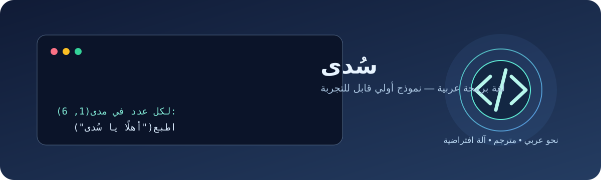
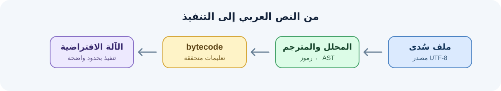

# سُدى — لغة برمجة عربية



**سُدى** لغة برمجة تجريبية عربية أولًا. باختصار: تكتب أوامرك بكلمات عربية
واضحة، والخلفية تحولها إلى تعليمات bytecode وتشغّلها بآلة افتراضية. نريد
الكتابة تكون بسيطة وقريبة للمبرمج العربي، والخلفية تبقى مرتبة وقابلة للتطوير.

> **الحالة الحالية:** سُدى نموذج أولي يعمل، وليس منتجًا نهائيًا أو مترجمًا أصليًا
> إلى تعليمات المعالج. يحوّل المترجم المصدر إلى bytecode خاص بسُدى، ثم تنفذه
> آلة افتراضية مكتوبة ببايثون. لذلك لا ندّعي أنها أسرع من Python أو أنها توفر
> حاليًا أطرًا مكتملة لتطبيقات الهاتف أو الويب أو الذكاء الاصطناعي.



## التثبيت السريع

يتطلب التشغيل **Python 3.11 أو أحدث** ووجود **Git**. ثبّت آخر نسخة موجودة في
هذا المستودع العام بأمر واحد:

```bash
python -m pip install "git+https://github.com/rayman938/suda-lang.git"
```

وبعدها تقدر تتأكد من التثبيت:

```bash
suda --version
```

لتنزيل الأمثلة والدليل وتشغيل برنامج جاهز:

```bash
git clone https://github.com/rayman938/suda-lang.git
cd suda-lang
suda run examples/مرحبا.sada
```

ما تحتاج مكتبات إضافية وقت التشغيل. على Windows إذا أمر `python` ما اشتغل،
جرّب `py -3` بدلًا منه بأوامر التثبيت.

## جرّب سُدى

احفظ المثال التالي في ملف `hello.sada` بترميز UTF-8:

```text
اسم = "العالم"
اطبع("مرحبًا يا", اسم)

مجموع = 0
لكل عدد في مدى(1, 6):
    مجموع = مجموع + عدد
اطبع("مجموع الأعداد من 1 إلى 5:", مجموع)

إذا مجموع == 15:
    اطبع("النتيجة صحيحة")
```

شغّله من مجلد المشروع:

```bash
suda run hello.sada
```

تستخدم اللغة كلمات مثل `إذا` و`وإلا` و`طالما` و`لكل` و`في` و`دالة` و`أرجع`.
تقدر تسمي المتغيرات والدوال بالعربي أو بالإنجليزي، وتستخدم الأعداد والنصوص
والقوائم والقواميس والدوال والشروط والحلقات. هاي أمثلة تعليمية؛ شوف البرامج
الموجودة بمجلد [`examples/`](examples/).

## شنو موجود بالإصدار 0.6.0؟

- محلل ومترجم يحولون المصدر العربي إلى bytecode.
- تحسين للمترجم يطوي العمليات الحسابية الثابتة الآمنة وقت الترجمة؛ إذا كانت
  العملية خطرة أو نتيجتها خارج الحدود، تبقى للتنفيذ العادي حتى يظهر الخطأ
  بمكانه الصحيح.
- مدقق للـbytecode يفحص تعليمات المكدس ومسارات القفز قبل التشغيل، حتى يرفض
  الملفات المشوهة بدل ما يتركها تسبب خللًا أثناء التنفيذ.
- آلة افتراضية بحدود للتعليمات والاستدعاءات والمجموعات والمخرجات.
- أوامر لفحص البرنامج وتشغيله وترجمته إلى bytecode وقراءة التعليمات.
- مكتبة أساسية صغيرة لأشياء مثل الطباعة والمدى والقوائم والقواميس والفرز.
- ضغط اختياري لملف bytecode بـzlib. الضغط يقلل حجم التخزين أو النقل أحيانًا،
  لكنه مو تشفير وما يسرّع تنفيذ البرنامج.
- اختبارات آلية وأمثلة، وأداة قياس حتى تقدر تعيد التجربة بدل الاعتماد على
  وعود عامة بالأداء.
- استوديو تعلّم لسطح المكتب بواجهتين: Tkinter الخفيفة، وPySide6 الاختيارية
  ذات التنسيق الأغنى. بيه محرر وتشغيل وأمثلة ودروس ومشاهد تعليمية مرسومة.
- تقرير تعليمي يشرح طريق التعلم والفوائد والحدود بمزيد من التفصيل.

## أوامر أساسية

```bash
suda check examples/حساب.sada
suda run examples/حساب.sada
suda compile examples/حساب.sada -o build/حساب.sbc --compress
suda disassemble build/حساب.sbc
suda run-bytecode build/حساب.sbc
```

يكتشف المشغّل تلقائيًا إن كان bytecode مضغوطًا أو بصيغة JSON غير مضغوطة.
التفاصيل والخيارات وحدود التنفيذ موضحة في [دليل لغة سُدى](docs/دليل-لغة-سدى.md).

## واجهة سطح المكتب

على Windows، افتح الواجهة الخفيفة:

```bash
suda gui
```

واجهة PySide6 اختيارية، وتستخدم حزمة Essentials التي تقتصر على مكونات Qt
اللازمة للواجهة بدل تنزيل إضافات Qt غير المستخدمة. تبقى أكبر بكثير من Tkinter.
بعد استنساخ المشروع:

```bash
git clone https://github.com/rayman938/suda-lang.git
cd suda-lang
python -m pip install ".[qt]"
suda gui --backend pyside6
```

أو ثبّتها مباشرة من GitHub:

```bash
python -m pip install "suda-lang[qt] @ git+https://github.com/rayman938/suda-lang.git"
suda gui --backend pyside6
```

الواجهة تعرض مشاهد تعليمية متحركة مرسومة للمشروع، مو ملفات فيديو MP4. الصوت
اختياري ويستخدم أصوات النظام المثبتة محليًا، بدون تنزيل أو تضمين تسجيلات
أشخاص. لتفعيله:

```bash
python -m pip install "suda-lang[voice] @ git+https://github.com/rayman938/suda-lang.git"
```

تحتاج الدبلجة العربية صوت نظام عربي مثبت؛ إذا مو موجود اختَر الصوت الإنجليزي.

## شنو بعده مو جاهز؟

سُدى بعدها نسخة تأسيسية للتجربة والتعلّم. ما بيها حاليًا
مترجم أصلي إلى كود آلة، أو مدير حزم، أو نظام وحدات، أو أدوات مكتملة لبناء
تطبيقات Android وiOS والويب، أو مكتبة ذكاء اصطناعي. كما أن واجهات الوصول
للملفات والشبكة وتشغيل أوامر النظام ليست ضمن المكتبة القياسية الحالية.
يعني هي بسيطة بالكتابة وخفيفة بالتبعيات، بس ما يصير نوصفها بأنها أقوى من
اللغات الثانية قبل ما تصير الميزات جاهزة وتنقاس على أرض الواقع. راجع قسم
الحالة وخارطة الطريق بالدليل قبل استخدامها بشغل إنتاجي.

## الحقوق والملكية

**سُدى واسمها وشيفرتها ووثائقها وأمثلتها محفوظة الحقوق لمؤلفها وصاحب
الحقوق المذكور في ملف [`LICENSE`](LICENSE): حساب GitHub `rayman938`.**
هذا المستودع عام ليتمكن الناس من الاطلاع عليه؛ نشر الشيفرة هنا لا يجعلها
ملكًا عامًا ولا يمنح ترخيصًا مفتوح المصدر. لا يُسمح، دون إذن كتابي مسبق من
صاحب الحقوق، بإعادة استخدام مواد المشروع أو نسخها أو تعديلها أو توزيعها أو
بيعها أو إنشاء أعمال مشتقة منها، ولا بادعاء تأليف اللغة أو ملكيتها. راجع
ملف الترخيص العربي/الإنجليزي داخل المستودع لأي استعمال مسموح به أو استفسار.

هذا إشعار بالموقف المقصود للمشروع وليس استشارة قانونية أو ضمانًا بأن كل شرط
قابل للتنفيذ في كل دولة؛ تبقى الحقوق والاستثناءات التي يفرضها القانون المحلي
سارية. ولأن المستودع عام، فالمحتوى المنشور فيه مرئي وقابل للفحص التقني؛
لا ترفع إليه أسرارًا أو مواد لا تريد نشرها.

## التثبيت من نسخة محلية والاختبار

```bash
python -m pip install .
python -m unittest discover -s tests -v
```

## ملفات المشروع

- [`src/suda/`](src/suda/): المحلل والمترجم والآلة الافتراضية وواجهة الأوامر.
- [`examples/`](examples/): برامج تجريبية بلغة سُدى.
- [`tests/`](tests/): اختبارات آلية لسلوك اللغة.
- [`benchmarks/`](benchmarks/): أداة قياس الأداء والحجم.
- [`docs/دليل-لغة-سدى.md`](docs/دليل-لغة-سدى.md): المرجع العربي الكامل للنحو
  والأوامر والأنواع والمكتبة والأمان والتصميم وخارطة الطريق.
- [`docs/مسار-تعلم-سدى.md`](docs/مسار-تعلم-سدى.md): تقرير التعلم والفوائد
  والتمارين ومشروع التدريب وحدود اللغة.
- [`docs/images/`](docs/images/): رسومات أصلية توضح سُدى ومراحل تنفيذ البرنامج.
- [`experiments/`](experiments/): تقارير تجارب الأداء والضغط.
- [`LICENSE`](LICENSE): إشعار الملكية وشروط الاستخدام.
